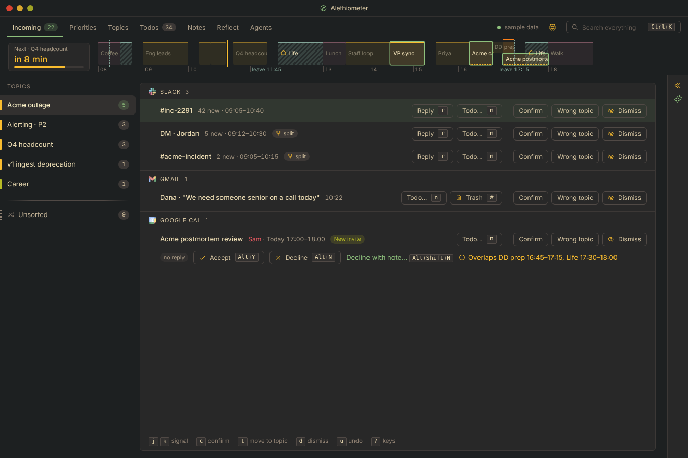
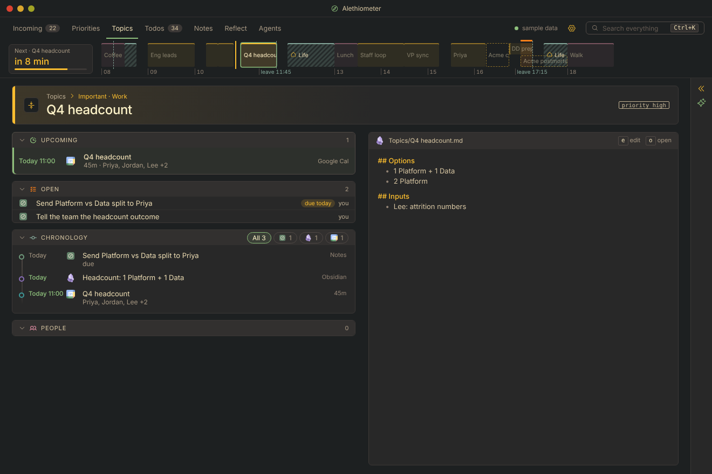

# Alethiometer

A personal, local-first tool for managing a working day and incoming interrupts. Mouse or 100% keyboard driven, it pulls signals from various sources, files what arrives into topics, and keeps notes, todos, and reflections associated together. It also has a tab for managing coding agents.

The AI features are BYOK and off until you configure a provider and pick models. No application data is sent anywhere you don't control.





## Status

Usable, but primarily built for one user. There is sample data if you wish to explore with configuring external connections. Slack, Gmail, Google Calendar, Jira, GitHub, and Obsidian connections all work and the AI features have been tested (although the Assistant is sparsely used).

Microsoft Teams, Proton Calendar, and Glean are tested only against recorded API responses. Developed primarily for Linux and MacOS, a Windows build type-checks but has not been run.

Known issues are in `ISSUES.md`.

## Get started

**[SETUP.md](SETUP.md)** walks through installing the prerequisites, running the app on sample data, and connecting your own accounts.

The short version, to see it in a browser with sample data:

```sh
cd app && npm ci
ALETHIOMETER_FAKE_NOW=10:52 npm run devserver   # Rust core on :1421 (first build takes a few minutes)
npm run dev                                      # in a second terminal; open http://localhost:1420
```

## How it's built

A Tauri 2 app: a Rust core with SQLite in `app/src-tauri`, a Svelte 5 UI in `app/src`, and a small agent host daemon in `app/agentd` that keeps coding agents running when the window closes. There is no mobile build. `app/README.md` has the architecture, the `settings.json` fields and the full key list.

## Building on it

Read `AGENTS.md` first: the engineering rules, and what to read next.

Checks:

- `cd app/src-tauri && cargo test --no-default-features`
- `cd app/agentd && cargo test`
- `cd app && npm run check`
- UI changes: `app/scripts/ui-diff.sh <ref>` and `node scripts/ui-diff.mjs` pixel-diff about 90 scenes against a git ref, and `node scripts/ui-keys.mjs` runs the keyboard checks (`app/docs/ui-plan.md`).

## License

Apache 2.0, see `LICENSE`.
